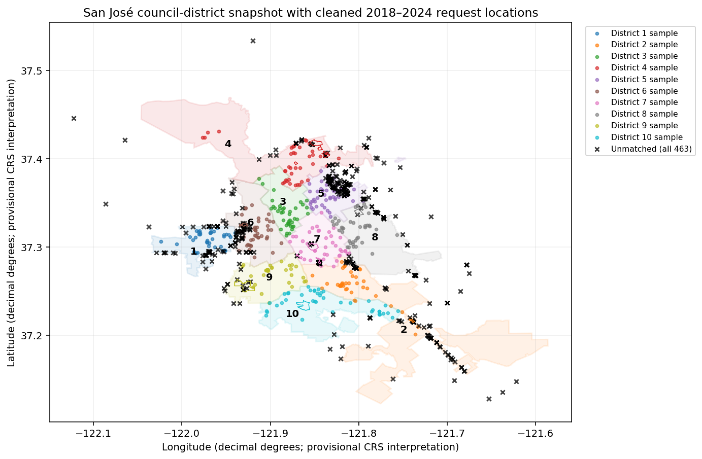
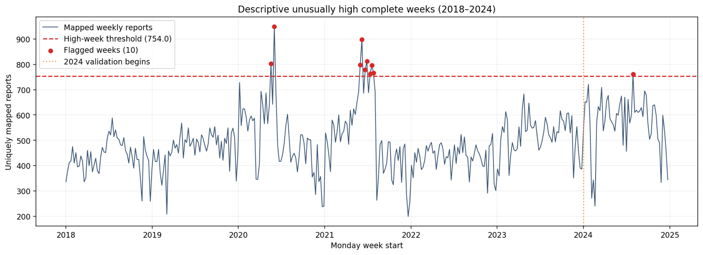
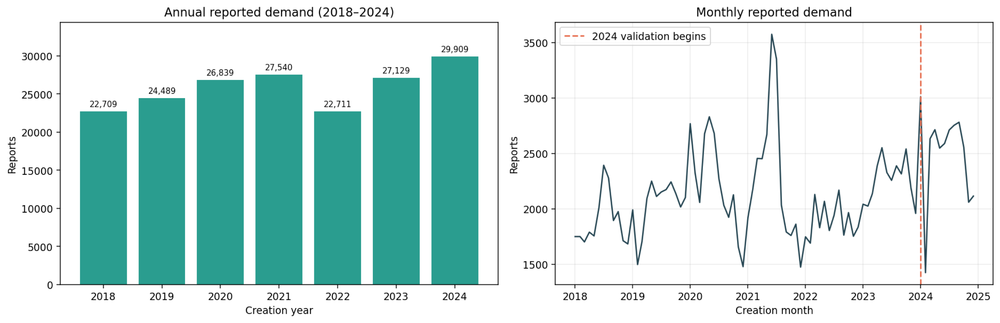
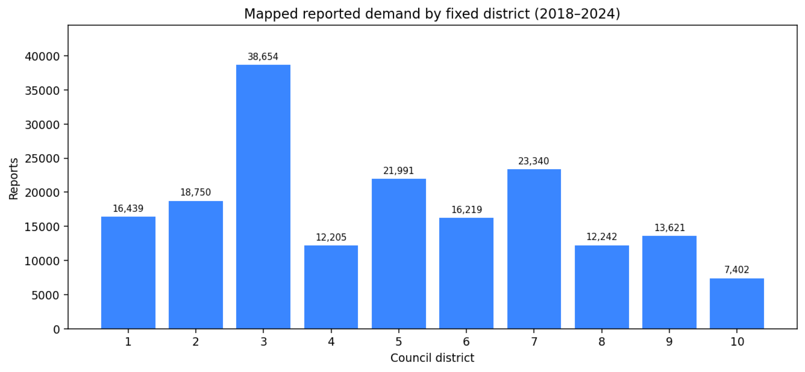
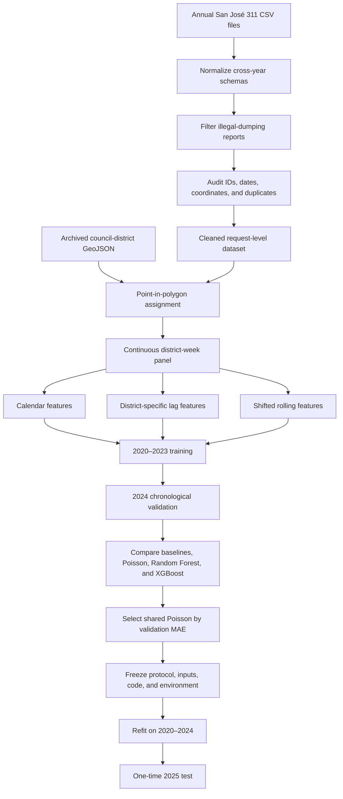
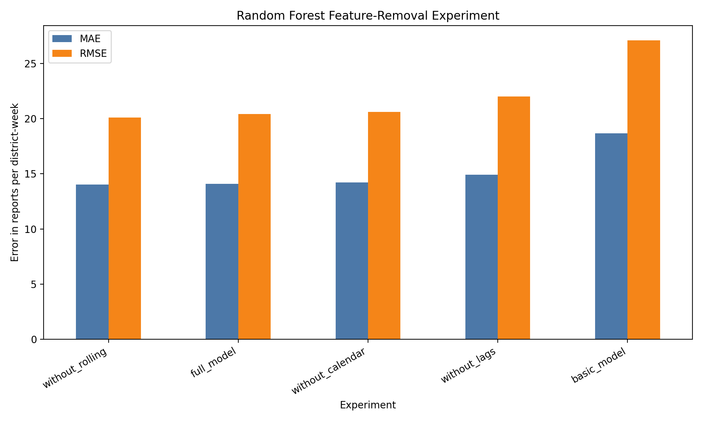
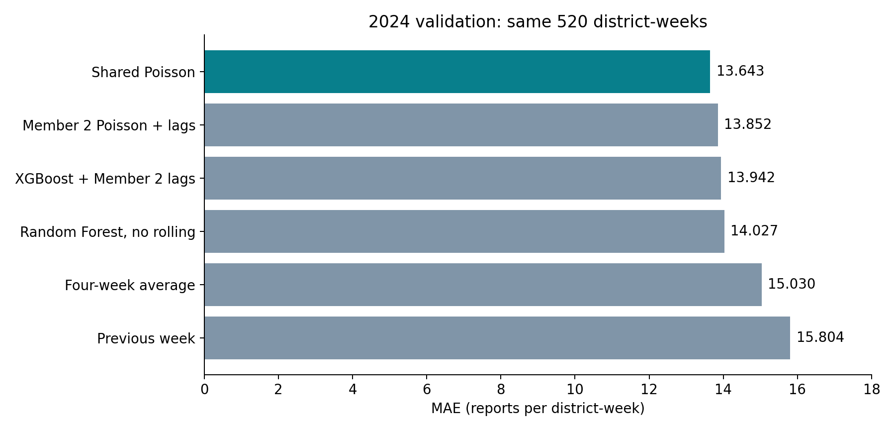
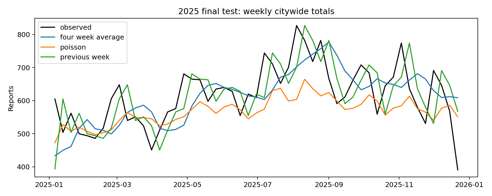
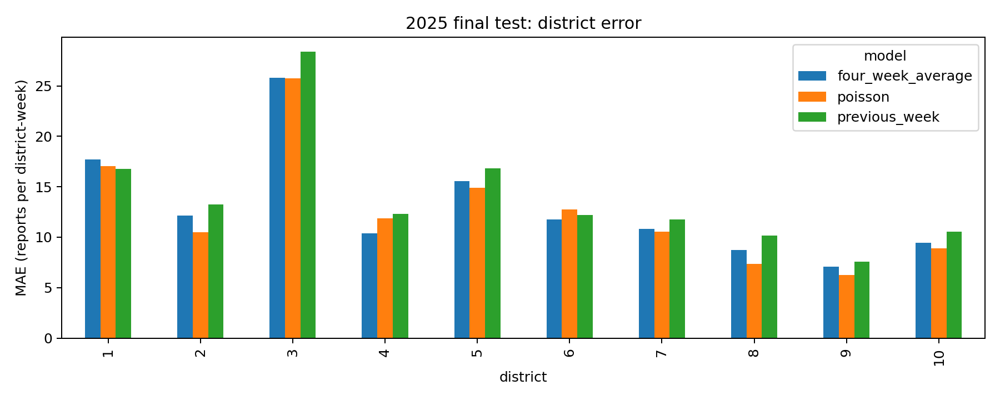

# San José 311 Illegal-Dumping Demand Forecasting

A reproducible machine-learning project for forecasting how many new illegal-dumping 311 reports each of San José’s ten City Council districts may receive during the next complete week.

The repository covers the full workflow: official data acquisition, cross-year cleaning, geographic assignment, exploratory analysis, leakage-safe feature engineering, baseline forecasting, Poisson regression, Random Forest, XGBoost, chronological validation, and a frozen 2025 final evaluation.

> [!IMPORTANT]
> This project forecasts **reported 311 demand**, not the true number of illegal-dumping incidents. Reporting behavior, access to 311 services, source-system coverage, and geographic assumptions all affect the observed counts.

## Table of contents

- [Project objective](#project-objective)
- [Why weekly demand forecasting?](#why-weekly-demand-forecasting)
- [Project at a glance](#project-at-a-glance)
- [Data sources](#data-sources)
- [Data preparation](#data-preparation)
- [Geographic assignment](#geographic-assignment)
- [Exploratory data analysis](#exploratory-data-analysis)
- [Machine-learning workflow](#machine-learning-workflow)
- [Feature engineering](#feature-engineering)
- [Models](#models)
- [Evaluation design](#evaluation-design)
- [Results](#results)
- [Error analysis and interpretation](#error-analysis-and-interpretation)
- [Repository structure](#repository-structure)
- [Getting started](#getting-started)
- [Reproducing the analyses](#reproducing-the-analyses)
- [Testing](#testing)
- [Team contributions](#team-contributions)
- [Challenges and lessons learned](#challenges-and-lessons-learned)
- [Limitations](#limitations)
- [Planned improvements](#planned-improvements)
- [References and acknowledgments](#references-and-acknowledgments)

## Project objective

The project asks:

> **How many new illegal-dumping reports will each San José City Council district receive next week?**

Each modeling observation represents:

```text
One council district × one complete Monday–Sunday week
```

The target is the number of retained, uniquely mapped illegal-dumping 311 reports created during that district-week.

Potential uses include:

- anticipating relative 311 workload;
- identifying districts and weeks likely to experience higher report volumes;
- supporting staffing and service-planning discussions;
- comparing simple forecasting rules with statistical and tree-based models; and
- documenting where forecasts are least reliable.

The project does **not**:

- predict individual illegal-dumping incidents;
- identify offenders or affected residents;
- measure all dumping activity in the city;
- establish why reporting volumes changed;
- evaluate cleanup quality or response times; or
- automatically allocate public resources.

An operational deployment would require additional work on reporting bias, staffing constraints, service outcomes, uncertainty, fairness, and decision costs.

## Why weekly demand forecasting?

The original project structure reserved workstreams for classification and resolution-time regression. Those tasks would require a verified completion or closure timestamp.

The available data contains `date_last_updated`, but the repository did not establish that this field represents the time a request was completed. Treating it as a closure timestamp could therefore create invalid resolution durations and labels.

The team selected weekly report-demand forecasting because `date_created` supports a clearly defined arrival target without inventing a completion event.

Two folder names remain from the original allocation:

- `notebooks/03_classification/` now contains **Random Forest count regression**.
- `notebooks/04_resolution_regression/` now contains **XGBoost count regression**.

## Project at a glance

| Item | Verified project definition |
|---|---|
| Domain | San José 311 illegal-dumping reports |
| Prediction unit | Council district-week |
| Forecast horizon | One complete week ahead |
| Districts | 10 |
| Cleaned data period | 2018–2025 |
| Historical feature support | 2018–2019 |
| Development training | 2020–2023 |
| Development validation | 2024 |
| Frozen final test | 2025 |
| Main metrics | MAE and RMSE |
| Selected model | Regularized Poisson regression |
| Comparison models | Previous week, four-week average, Random Forest, XGBoost |
| Best 2024 validation MAE | 13.643 reports per district-week |
| Best 2025 test MAE | 12.590 reports per district-week |
| Best 2025 test RMSE | 17.247, achieved by the four-week average |

## Data sources

### San José 311 service requests

The cleaning pipeline discovers annual CSV resources through the City of San José CKAN API.

- [City of San José 311 Service Request Data](https://data.sanjoseca.gov/dataset/311-service-request-data)
- Committed cleaned dataset: `data/processed/illegal_dumping_cleaned.csv`
- Committed source audit: `data/processed/source_manifest.csv`

The committed source snapshot covers 2018–2025. Re-downloading the official files later may produce different data if the publisher revises its resources.

### Council district boundaries

The repository includes an archived City Council district layer:

- `data/reference/council_districts_snapshot.geojson`
- `data/reference/council_districts_metadata.json`
- [City of San José Council District ArcGIS layer](https://geo.sanjoseca.gov/server/rest/services/PLN/PLN_AdministrativeBoundaries/MapServer/1)

The snapshot contains valid polygon or multipolygon geometries for Districts 1–10.

The source metadata describes the current 2021-redistricting boundaries, effective February 11, 2022, with possible later annexation or city-boundary updates. Applying this single snapshot to older requests creates a consistent retrospective geography; it does not reconstruct the district legally in effect when every historical request was submitted.

## Data preparation

The committed cleaning run processed eight annual files from 2018 through 2025.

| Cleaning stage | Records |
|---|---:|
| Source rows across all years | 2,002,143 |
| Illegal-dumping rows before quality rules | 214,502 |
| Excluded for missing IDs, invalid dates, or implausible coordinates | 1,071 |
| Exact duplicate rows removed | 0 |
| Repeated request IDs removed | 0 |
| **Final retained records** | **213,431** |

The pipeline in `src/data_preparation.py`:

1. queries the official CKAN catalog for annual resources;
2. downloads the requested CSV files;
3. normalizes changing column names to a shared schema;
4. identifies illegal-dumping records from `service_type` or `category`;
5. parses request identifiers, timestamps, and coordinates;
6. records missingness and source-file checksums;
7. excludes records that cannot be reliably identified or placed in time;
8. rejects non-missing coordinates outside the project’s San José plausibility bounds;
9. removes exact and request-ID duplicates; and
10. writes the cleaned handoff, source manifest, audit rows, cleaning counts, and data dictionary.

### Cleaned schema

| Field | Meaning |
|---|---|
| `request_id` | Unique 311 request identifier |
| `status` | Status supplied by the source |
| `source` | Request-submission channel |
| `category` | Original source category |
| `service_type` | Canonical `Illegal Dumping` label after filtering |
| `latitude`, `longitude` | Request coordinates |
| `date_created` | Parsed creation timestamp used for forecasting |
| `date_last_updated` | Source update timestamp; not assumed to be completion time |
| `department` | Source department |
| `source_year` | Annual source file from which the row came |

Detailed rules are documented in [`notebooks/01_data_preparation/README.md`](notebooks/01_data_preparation/README.md) and [`data/README.md`](data/README.md).

## Geographic assignment

Requests are assigned to archived council districts by constructing points as `(longitude, latitude)` and applying polygon coverage tests.

For the 2018–2024 development period:

| Geographic check | Requests |
|---|---:|
| Cleaned development-period requests | 181,326 |
| Uniquely assigned to one district | 180,863 |
| Outside all archived district polygons | 463 |
| Assigned to multiple districts | 0 |

Only requests matching exactly one district contribute to the district-level forecasting target. Unmatched requests are retained in audit evidence rather than forced into the nearest district.



The complete audit and its limitations are documented in [`notebooks/02_eda_features/district_map_verification.md`](notebooks/02_eda_features/district_map_verification.md).

## Exploratory data analysis

EDA was performed on the development period without using 2025 to create features, select models, or calculate development metrics.

### Verified findings

- The 2018–2024 development panel contains **365 complete week starts** across ten districts.
- The complete-week target contains **180,732 uniquely mapped reports**.
- Another 131 mapped reports belong to the week starting December 30, 2024, which crosses into 2025 and is excluded from development scoring.
- Development-period mapped volume increased from **22,709 reports in 2018** to **29,909 in 2024**, although the path was not monotonic.
- District 3 has the largest fixed-map total: **38,654 reports**, or 21.37% of uniquely mapped development reports.
- District 10 has the smallest fixed-map total: **7,402 reports**.
- Tuesday is the most common creation weekday.
- Reporting falls sharply on weekends.
- `Public API` is the most common exact source-channel label in the saved EDA.
- The original `category` field is missing for approximately 97.7% of cleaned rows.
- Ten development weeks exceeded the declared `Q3 + 1.5 × IQR` citywide volume screen.

The high-volume screen is descriptive. A flagged week is not evidence of a confirmed dumping event or its cause.







Raw district totals are not adjusted for population, land area, land use, reporting access, boundary history, or service-channel availability.

## Machine-learning workflow



## Feature engineering

All historical-demand features are computed independently within each district on a continuous weekly grid.

### District identity

Council district is treated as a categorical variable. The Poisson, Random Forest, and XGBoost pipelines one-hot encode district identity.

### Calendar features

| Feature | Definition |
|---|---|
| `month` | Calendar month of `week_start` |
| `week_of_year` | ISO week number |
| `sin_year` | Sine of annual calendar position |
| `cos_year` | Cosine of annual calendar position |

The cyclic sine and cosine terms avoid treating late December and early January as maximally distant calendar positions.

### Lag features

| Feature | Definition |
|---|---|
| `lag_1` | Count one completed week earlier |
| `lag_2` | Count two completed weeks earlier |
| `lag_4` | Count four completed weeks earlier |
| `lag_8` | Count eight completed weeks earlier |

### Rolling-history features

| Feature | Definition |
|---|---|
| `rolling_4` | Mean of the previous four completed weeks |
| `rolling_8` | Mean of the previous eight completed weeks |
| `rolling_13` | Mean of the previous thirteen completed weeks |
| `rolling_std_4` | Sample standard deviation over the previous four weeks |
| `rolling_std_8` | Sample standard deviation over the previous eight weeks |
| `recent_change_1_4` | `lag_1 - rolling_4` |

Every rolling calculation shifts the district series by one week before aggregation. The target for the week being predicted cannot enter its own predictors.

The field-level specification is available in [`notebooks/02_eda_features/feature_dictionary.csv`](notebooks/02_eda_features/feature_dictionary.csv).

## Models

### Previous-week baseline

Predicts that the new week will equal the most recently completed week:

\[
\hat{y}_{d,t}=y_{d,t-1}
\]

This baseline tests whether a model improves upon simple persistence.

### Four-week-average baseline

Predicts the mean of the previous four completed weeks:

\[
\hat{y}_{d,t}=\frac{1}{4}\sum_{i=1}^{4}y_{d,t-i}
\]

It is a strong, transparent reference that smooths short-term volatility.

### Poisson regression

The selected shared model uses:

- district identity;
- `lag_1`, `lag_2`, and `lag_4`;
- `rolling_4` and `rolling_13`;
- `sin_year` and `cos_year`;
- one-hot district encoding;
- standardized numeric features; and
- `PoissonRegressor(alpha=1.0, max_iter=2000, tol=1e-8)`.

The regularized Poisson model produces non-negative expected counts through its log link. The observed results do not prove that the target strictly follows a Poisson distribution or has equal mean and variance.

### Random Forest

The Random Forest workstream compares five feature-removal configurations using:

- `RandomForestRegressor`;
- 300 trees;
- `random_state=42`;
- `min_samples_leaf=2`; and
- identical 2020–2023 training and 2024 validation rows.

Its strongest saved configuration keeps district, annual cyclic terms, and lags 1, 2, and 4 while removing rolling averages.



### XGBoost

The XGBoost workstream compares shared, lag-focused, and full feature sets using a fixed configuration:

| Parameter | Value |
|---|---:|
| Objective | `reg:squarederror` |
| Trees | 250 |
| Maximum depth | 4 |
| Learning rate | 0.05 |
| Subsample | 0.85 |
| Column sample by tree | 0.85 |
| Minimum child weight | 3 |
| L2 regularization | 1.0 |
| Tree method | `hist` |
| Random seed | 42 |

The primary saved XGBoost experiment uses calendar variables plus lags 1, 2, 4, and 8.

Member 4’s results were reproduced in a separate Windows environment using Python 3.13.15 and XGBoost 3.4.1. The repository records that earlier platform review produced different XGBoost scores, so the pinned Member 4 environment should be used for exact reproduction.

## Evaluation design

### Chronological periods

| Period | Purpose |
|---|---|
| 2018–2019 | Historical context and lag support |
| 2020–2023 | Development training |
| 2024 | Model development and validation |
| 2025 | Frozen final test |

### Development validation

The 2024 validation set contains:

- 52 complete Monday–Sunday weeks;
- ten council districts; and
- 520 district-week observations per model.

The last scored validation week starts December 23, 2024. The week starting December 30 crosses into 2025, so it is retained only where needed as history and is not scored as a development week.

All six summarized validation configurations were reconciled on the same district-week keys and observed targets.

### Rolling one-week-ahead interpretation

The coefficients or trees remain fixed throughout an evaluation period, but each forecast may use the actual counts from already completed earlier weeks.

Therefore, the experiment represents repeated one-week-ahead forecasting. It is not a single forecast for an entire year made on January 1.

### Frozen final test

The selected Poisson configuration was chosen using 2024 validation MAE. Before the 2025 evaluation, the repository recorded:

- the cleaned-data checksum;
- the district-boundary checksum;
- the selected model settings;
- the refit and test periods;
- implementation and requirements checksums;
- runtime library versions; and
- six documented data conventions.

The model was then refitted on **2,600 district-weeks from 2020–2024** and tested on **510 district-weeks**: ten districts across the 51 complete weeks beginning January 6 through December 22, 2025.

The first and last boundary-crossing weeks were not scored. No Random Forest or XGBoost configuration was evaluated on this frozen test.

### Metrics

For actual counts \(y_i\) and predictions \(\hat{y}_i\):

\[
\text{MAE}=\frac{1}{n}\sum_{i=1}^{n}|y_i-\hat{y}_i|
\]

\[
\text{RMSE}=\sqrt{\frac{1}{n}\sum_{i=1}^{n}(y_i-\hat{y}_i)^2}
\]

MAE is the average absolute error in reports per district-week. RMSE gives more weight to large misses. Lower values are better.

## Results

### 2024 development validation

These are model-development results, not final-test results.

| Model or configuration | Validation rows | MAE | RMSE | Mean signed error |
|---|---:|---:|---:|---:|
| **Shared Poisson** | 520 | **13.643** | **19.132** | −3.452 |
| Member 2 Poisson + lags | 520 | 13.852 | 19.482 | −3.816 |
| XGBoost + Member 2 lags | 520 | 13.942 | 20.195 | −2.446 |
| Random Forest without rolling | 520 | 14.027 | 20.107 | −2.655 |
| Four-week average | 520 | 15.030 | 20.714 | −0.116 |
| Previous week | 520 | 15.804 | 22.271 | 0.081 |

The selected shared Poisson model reduced validation MAE by approximately **9.23%** relative to the four-week-average baseline.



The small differences among trained models have not been tested for statistical significance. Because 2024 was repeatedly used for development, the table should be interpreted as a comparison of recorded experiments rather than proof that one algorithm is universally superior.

### Member 2 controlled Poisson ablation

This experiment holds the model, training rows, validation rows, preprocessing, and target constant while changing the numeric feature group.

| Feature group | MAE | RMSE |
|---|---:|---:|
| District + calendar | 17.861 | 24.532 |
| **District + calendar + lags** | **13.852** | **19.482** |
| District + calendar + lags + rolling/change | 14.131 | 19.781 |

Adding lags reduced MAE by **22.45%** relative to the calendar-only group. Adding the full rolling/change group did not improve MAE or RMSE beyond the lag-focused group.

### Random Forest ablation

| Configuration | MAE | RMSE |
|---|---:|---:|
| **Without rolling features** | **14.027** | **20.107** |
| Full model | 14.090 | 20.413 |
| Without calendar features | 14.221 | 20.626 |
| Without lag features | 14.917 | 22.017 |
| Basic district/calendar model | 18.675 | 27.101 |

Removing lag features caused a larger performance loss than removing calendar or rolling features. This supports the importance of recent district-level history in the saved validation period.

### XGBoost feature comparison

| Configuration | MAE | RMSE |
|---|---:|---:|
| Shared forecasting features | 14.171 | 20.325 |
| **Calendar + lags** | **13.942** | **20.195** |
| Full Member 2 feature set | 14.007 | 20.356 |

XGBoost improved upon both simple baselines on 2024 validation but did not outperform the selected Poisson model.

### Verified 2025 final test

Only the selected Poisson model and the two baselines were scored on the frozen test.

| Forecast | Training rows | Test rows | Test MAE | Test RMSE |
|---|---:|---:|---:|---:|
| Previous week | 2,600 | 510 | 13.975 | 19.065 |
| Four-week average | 2,600 | 510 | 12.949 | **17.247** |
| **Poisson** | 2,600 | 510 | **12.590** | 17.528 |

The final results have an important split conclusion:

- Poisson achieved the **lowest MAE**, improving upon the four-week average by approximately **2.77%**.
- The four-week average achieved the **lowest RMSE**, meaning it performed better under a metric that penalizes the largest misses more heavily.
- Random Forest and XGBoost results remain validation-only and must not be described as 2025 test results.





## Error analysis and interpretation

### District variation

Forecast difficulty differs substantially across districts.

On the 2025 test, Poisson district-level MAE ranged from approximately:

- **6.28** reports per week in District 9; to
- **25.76** reports per week in District 3.

These are raw-count errors. They are influenced by district volume and must not be interpreted as population-adjusted performance, service quality, or equity rankings.

### Large validation misses

A common difficult case across the saved 2024 experiments is District 3 during the week beginning July 29, 2024:

| Model | Actual | Prediction | Absolute error |
|---|---:|---:|---:|
| Shared Poisson | 227 | 123.414 | 103.586 |
| Member 2 lag Poisson | 227 | approximately 119.0 | approximately 108.0 |
| Random Forest without rolling | 227 | 124.82 | 102.18 |
| XGBoost with lag features | 227 | 115.20 | 111.80 |

This example demonstrates difficulty forecasting abrupt demand spikes. It does not identify why that week had an unusually high report count.

### High-demand weeks

The saved Random Forest, Poisson, and XGBoost diagnostics consistently show larger errors during unusually busy district-weeks.

For the primary XGBoost experiment:

- 123 post-hoc busy validation observations had MAE **23.42**;
- 397 nonbusy observations had MAE **11.01**; and
- the average signed error on busy observations was **−22.19**, showing underprediction.

The busy label uses observed validation counts after the forecast is made. It is an error-analysis grouping, not a model input or an advance busy-week classifier.

### What the results suggest

The experiments support four measured conclusions:

1. Recent district-level counts are more useful than calendar features alone.
2. More features do not automatically improve validation performance.
3. A regularized count model can compete with more flexible tree ensembles on this dataset.
4. Sudden high-demand weeks remain the main forecasting weakness.

They do not establish why reports occur, why one district has more reports, or which operational intervention would be effective.

## Repository structure

```text
.
├── .github/
│   ├── ISSUE_TEMPLATE/
│   │   └── task.md
│   └── pull_request_template.md
├── config/
│   └── final_evaluation_protocol.json
├── data/
│   ├── raw/                            # Optional downloaded annual CSVs; ignored
│   ├── processed/
│   │   ├── illegal_dumping_cleaned.csv
│   │   ├── source_manifest.csv
│   │   ├── cleaning_counts.csv
│   │   └── data_dictionary.csv
│   ├── reference/
│   │   ├── council_districts_snapshot.geojson
│   │   └── council_districts_metadata.json
│   └── README.md
├── notebooks/
│   ├── 01_data_preparation/            # Cleaning documentation
│   ├── 02_eda_features/                # Map audit, EDA, features, ablations
│   ├── 03_classification/              # Random Forest demand regression
│   ├── 04_resolution_regression/       # XGBoost demand regression
│   └── 05_demand_forecasting/          # Shared and final forecasting notebooks
├── reports/
│   ├── figures/                        # Committed plots for all workstreams
│   └── presentation/                   # Member 5 presentation deck
├── results/
│   ├── demand_forecasting/             # Shared 2024 validation evidence
│   ├── demand_forecasting_final/       # Frozen 2025 test evidence
│   ├── forecasting_presentation/       # Aligned six-model comparison
│   ├── member2/                        # Feature-ablation evidence
│   ├── member3_random_forest/          # RF predictions and diagnostics
│   ├── member4_xgboost/                # XGBoost predictions and diagnostics
│   └── member4_presentation/
├── src/
│   ├── data_preparation.py
│   ├── demand_forecasting.py
│   ├── eda_features.py
│   ├── feature_comparison.py
│   ├── final_evaluation.py
│   └── forecasting_summary.py
├── tests/
│   ├── test_demand_forecasting.py
│   ├── test_eda_features.py
│   ├── test_feature_comparison.py
│   └── test_final_evaluation.py
├── CONTRIBUTING.md
├── requirements-forecasting.txt
└── README.md
```

Important generated intermediate:

```text
data/processed/district_week_development.csv
```

This file is intentionally ignored by Git. It is created by `src/demand_forecasting.py` and is required before running the Random Forest or XGBoost training scripts.

## Getting started

### Prerequisites

For the shared pipeline:

- Git
- Python 3.9.6 for the exact frozen environment, or a compatible Python environment
- `venv` support
- internet access only if rebuilding the annual source data

The saved EDA notebooks were also reproduced with Python 3.11.15 and the pinned shared package versions. Exact final-evaluation provenance records Python 3.9.6.

### 1. Clone the repository

```bash
git clone https://github.com/Revanth0211/data245-san-jose-311-ml.git
cd data245-san-jose-311-ml
```

### 2. Create the shared environment

macOS or Linux:

```bash
python3 -m venv .venv
source .venv/bin/activate
python -m pip install --upgrade pip
python -m pip install -r requirements-forecasting.txt
```

Windows PowerShell:

```powershell
py -m venv .venv
.venv\Scripts\Activate.ps1
python -m pip install --upgrade pip
python -m pip install -r requirements-forecasting.txt
```

The shared requirements pin:

- NumPy 1.26.4
- pandas 2.3.3
- scikit-learn 1.6.1
- Shapely 2.0.7
- Matplotlib 3.9.4
- notebook execution support libraries

### 3. Run the shared tests

```bash
python -m unittest discover -s tests -v
```

### 4. Rebuild the development forecasts

The cleaned dataset and district snapshot are already committed.

```bash
python src/demand_forecasting.py
```

This command:

- maps cleaned 2018–2024 requests to districts;
- constructs the continuous weekly panel;
- creates shared historical features;
- evaluates the baselines and Poisson model on 2024;
- writes `data/processed/district_week_development.csv`;
- regenerates validation metrics and predictions; and
- regenerates the shared validation figures.

### 5. Reconcile the saved validation experiments

```bash
python src/forecasting_summary.py
```

This reads committed prediction files, verifies that all six configurations use the same 520 validation keys and targets, and regenerates the comparison tables and figures.

## Reproducing the analyses

Run all commands from the repository root.

### Data preparation

A cleaned dataset is committed, so downloading approximately two million source rows is not required for ordinary use.

To rebuild the request-level data from the current official resources:

```bash
python src/data_preparation.py \
  --years 2018 2019 2020 2021 2022 2023 2024 2025
```

> [!WARNING]
> This command accesses the live CKAN catalog and rewrites files under `data/processed/`. Current official resources may differ from the source snapshot used for the committed results.

### EDA and feature engineering

Run the notebooks in this order:

1. `notebooks/02_eda_features/01_district_map_verification.ipynb`
2. `notebooks/02_eda_features/02_exploratory_data_analysis.ipynb`
3. `notebooks/02_eda_features/03_feature_engineering.ipynb`
4. `notebooks/02_eda_features/04_feature_comparison.ipynb`

The notebooks locate the repository root dynamically and use repository-relative paths.

If a Jupyter interface is needed, install it into the shared environment:

```bash
python -m pip install jupyterlab
python -m jupyter lab
```

JupyterLab itself is not pinned by `requirements-forecasting.txt`; use the committed executed notebooks for the recorded evidence.

### Shared Poisson forecasting

Script:

```bash
python src/demand_forecasting.py
```

Notebook:

```text
notebooks/05_demand_forecasting/weekly_demand_forecasting.ipynb
```

A self-contained demonstration is also available:

```text
notebooks/05_demand_forecasting/live_forecast_demo.ipynb
```

The live demo contains aggregated weekly counts and reproduces the selected 2024 and 2025 Poisson/baseline scores without rewriting the committed final-evaluation artifacts.

### Random Forest

First generate the ignored shared panel:

```bash
python src/demand_forecasting.py
```

Then run:

```bash
python notebooks/03_classification/random_forest_forecasting.py
python notebooks/03_classification/random_forest_error_analysis.py
```

The scripts regenerate the Random Forest metrics, row-level predictions, largest-error tables, and figures.

### XGBoost

Member 4 uses a separate environment because its pinned NumPy, scikit-learn, and XGBoost versions differ from the shared environment.

Do not install both requirements files into the same virtual environment.

macOS or Linux:

```bash
python3.13 -m venv .venv-xgb
source .venv-xgb/bin/activate
python -m pip install --upgrade pip
python -m pip install -r notebooks/04_resolution_regression/requirements_member4.txt
python -m pip check
```

Windows PowerShell:

```powershell
py -3.13 -m venv .venv-xgb
.venv-xgb\Scripts\Activate.ps1
python -m pip install --upgrade pip
python -m pip install -r notebooks/04_resolution_regression/requirements_member4.txt
python -m pip check
```

Generate the shared panel before fitting XGBoost:

```bash
python src/demand_forecasting.py
python notebooks/04_resolution_regression/member4_xgboost.py \
  --provisional \
  --with-member2
```

Run the Member 4 tests:

```bash
python -m unittest discover \
  -s notebooks/04_resolution_regression \
  -p test_member4_xgboost.py \
  -v
```

Exact saved XGBoost reproduction is documented in [`notebooks/04_resolution_regression/README.md`](notebooks/04_resolution_regression/README.md).

### Frozen final evaluation

The committed checkout already contains:

- `results/demand_forecasting_final/protocol_lock.json`;
- `results/demand_forecasting_final/evaluation_started.json`;
- final predictions;
- final metrics;
- district diagnostics; and
- a run manifest.

The evaluator deliberately prevents an accidental second evaluation after outcomes have been exposed. Do not delete the guard or overwrite the frozen evidence merely to rerun it.

Inspect the recorded results directly:

```text
results/demand_forecasting_final/test_metrics.csv
results/demand_forecasting_final/test_predictions.csv
results/demand_forecasting_final/district_metrics.csv
results/demand_forecasting_final/run_manifest.json
```

Use `notebooks/05_demand_forecasting/live_forecast_demo.ipynb` for a non-destructive educational replay.

## Testing

The shared suite defines 30 tests across four files.

It checks:

- continuous seven-day weekly grids;
- correct lag values;
- correct rolling means and standard deviations;
- separation of district histories;
- prevention of current-target leakage;
- prevention of future-target leakage;
- correct year-boundary behavior;
- exclusion of split-crossing weeks;
- exclusion of 2025 from development evaluation;
- preservation of district-week keys and targets;
- identical cohorts across feature ablations;
- training-only preprocessing;
- finite, non-negative predictions;
- explicit acknowledgement of provisional assumptions;
- committed teammate-file checksums;
- frozen input and implementation checks;
- complete 2025 week selection; and
- prevention of repeated final evaluation.

Run:

```bash
python -m unittest discover -s tests -v
```

Member 2’s committed evidence records 22 passing EDA and feature-comparison tests. Member 4’s documentation records 17 passing XGBoost tests in its pinned Windows environment.

## Team contributions

The assignments below are supported by committed files, commit authorship, merge history, notebooks, saved results, and team documentation. Commit counts are not treated as a measure of contribution.

| Member | Verified responsibility | Primary evidence |
|---|---|---|
| Abhijith Reddy — Member 1 | Data acquisition, schema harmonization, illegal-dumping filtering, quality checks, deduplication, cleaning audit, and data dictionary | Commit `275e496`; `src/data_preparation.py`; `notebooks/01_data_preparation/README.md`; `results/member1_cleaning_summary.csv` |
| Haritha Gottumukkala — Member 2 | District-map verification, EDA, leakage-safe features, Poisson feature ablation, validation diagnostics, presentation figures, and associated tests | Commits `b2b7396`, `07543fa`, `a02759a`; `notebooks/02_eda_features/`; `src/eda_features.py`; `src/feature_comparison.py`; `results/member2/` |
| Divija Puli — Member 3 | Random Forest feature-removal experiments, row-level validation predictions, district error analysis, large-error analysis, and presentation documentation | Commits `08c1071`, `61d4d36`; `notebooks/03_classification/`; `results/member3_random_forest/` |
| Xinghan Chen — Member 4 | XGBoost forecasting, feature-set comparison, pinned environment, tests, district/busy-week analysis, feature importance, and presentation assets | Commits `810d200`, `623bf08`, `d461a20`, `b45f8fa`; `notebooks/04_resolution_regression/`; `results/member4_xgboost/` |
| Srinidhi Jaya Revanth Srirangarajapally — Member 5 | Repository setup, shared district-week pipeline, baselines, Poisson validation, training-window comparison, integration, frozen-test recording, documentation, and self-contained live demonstration | Commits `65059c7`, `9c06d0c`, `632e78b`, `9cb13ce`, `ae8bf28`; `src/demand_forecasting.py`; `notebooks/05_demand_forecasting/`; `results/demand_forecasting_final/` |

### Member 1 — data preparation

Verified deliverables include:

- official CKAN resource discovery;
- annual CSV download and checksums;
- cross-year schema normalization;
- illegal-dumping label matching;
- request ID, timestamp, coordinate, and duplicate checks;
- cleaned 2018–2025 request data;
- source and exclusion audits; and
- the canonical data dictionary.

### Member 2 — geography, EDA, and features

Verified deliverables include:

- district polygon and identifier validation;
- unmatched and boundary-sensitive point analysis;
- descriptive time, channel, and district analyses;
- calendar, lag, rolling, variation, and change features;
- controlled Poisson feature ablation;
- field-level feature documentation;
- 2024 district and high-demand error evidence; and
- reusable tests for temporal ordering and cohort identity.

### Member 3 — Random Forest

Verified deliverables include:

- five controlled Random Forest feature configurations;
- fixed random seed and model settings;
- common-row training and validation;
- row-level validation forecasts;
- district-level MAE and bias analysis;
- largest overprediction and underprediction tables; and
- final presentation material.

### Member 4 — XGBoost

Verified deliverables include:

- three XGBoost feature configurations;
- a separately pinned Python/XGBoost environment;
- shared-panel and validation-row cross-checks;
- district, busy-week, and citywide error analysis;
- model-provided feature importance;
- 17 documented tests;
- run-manifest provenance; and
- final presentation assets.

### Member 5 — shared forecasting and integration

Verified deliverables include:

- the archived district data and metadata;
- common point-to-district assignment;
- continuous district-week panel construction;
- previous-week and four-week-average baselines;
- the shared Poisson pipeline;
- 2018-start versus 2020-start validation;
- aligned cross-model validation evidence;
- the recorded frozen 2025 evaluation;
- integration and reproducibility documentation; and
- the self-contained live forecast notebook.

### Attribution boundary

Some integration and final-evaluation automation first appeared in a commit authored as `Codex <codex@users.noreply.github.com>`. Repository documentation assigns the forecasting/integration workstream to Member 5, and a later Member 5-authored commit recorded the frozen 2025 evaluation.

Git history alone cannot verify:

- hours worked;
- informal discussions;
- reviews conducted outside committed artifacts;
- uncommitted assistance;
- work stored in external documents; or
- the individual human authorship of automation-authored lines.

AI assistance is acknowledged in the project documentation as supporting implementation, tests, explanations, and experiment documentation.

## Challenges and lessons learned

### Reliable target definition came before model choice

The absence of a verified completion timestamp ruled out defensible closure-time targets. The team changed the shared task rather than building models on an unsupported label.

### Spatial consistency required explicit tradeoffs

A single archived map makes the district series internally consistent, but it sacrifices historical legal-boundary fidelity. The project records this as a limitation instead of silently presenting the assignments as historically exact.

### Time-series leakage can be subtle

A rolling mean that includes the current row would directly expose the target. Missing weeks can also cause a row shift to mean “previous available row” rather than “previous calendar week.” Continuous-grid validation and shift-before-rolling logic address both risks.

### Flexible models were not automatically better

Random Forest and XGBoost were competitive but did not beat the selected regularized Poisson model on the shared validation set. The experiments emphasize controlled comparison rather than algorithm complexity.

### Sudden spikes dominate large errors

The models tend to forecast toward recent district levels. Abrupt high-demand weeks therefore produce the largest underpredictions and remain the clearest opportunity for improvement.

### Reproducibility includes software and platform details

XGBoost results varied during cross-platform review. The repository consequently preserves a separate pinned environment and run manifest for that workstream.

## Limitations

1. **Reports are not incidents.** Multiple requests may describe one event, while other events may never be reported.

2. **Annual source completeness was assumed, not independently proven.** A missing interval could be mistaken for zero demand.

3. **Zero filling depends on coverage.** The model treats absent district-week combinations as zero only under the documented completeness convention.

4. **Timestamps are naive.** Creation times are treated as San José local wall-clock values, but the source timezone semantics were not independently established.

5. **Geography is retrospective.** One archived current/2021-redistricting map is applied to all historical years.

6. **The saved GeoJSON does not declare a CRS.** Its coordinate ranges support the project’s longitude/latitude interpretation, while the source layer metadata describes a projected native coordinate system. The exact export request was not preserved.

7. **Unmatched requests are excluded from district demand.** There were 463 such requests during 2018–2024.

8. **Upstream exclusions may be systematic.** The cleaning pipeline excluded 1,071 records under its quality rules.

9. **District comparisons use raw counts.** They are not adjusted for population, area, land use, reporting access, socioeconomic conditions, or boundary history.

10. **2024 was reused for model development.** Repeated comparisons can adapt decisions to that validation year.

11. **The tree models were not included in the final test.** Their recorded metrics are validation results only.

12. **No prediction intervals are provided.** The models produce point forecasts without calibrated uncertainty.

13. **No causal conclusions are supported.** Feature importance and forecast errors do not explain why illegal-dumping reports occur.

14. **Operational effectiveness was not evaluated.** Forecast accuracy alone does not prove that a staffing or routing intervention would improve outcomes.

15. **No repository license is currently committed.** The absence of a license should be resolved before broader reuse or redistribution.

## Planned improvements

The following are proposed extensions, not completed project results:

- confirm source completeness and timezone semantics with official documentation;
- preserve the exact district-layer export query and output CRS;
- test historically appropriate council boundaries;
- examine the unmatched and upstream-excluded requests in more detail;
- add rolling-origin or multi-year time-series cross-validation;
- compare Poisson with negative-binomial or other overdispersion-aware count models;
- construct calibrated prediction intervals;
- incorporate only genuinely forecast-available external features, such as weather or scheduled service information;
- investigate robust methods for sudden demand spikes;
- refit tree models under a newly frozen protocol before any future test comparison;
- evaluate population- or exposure-normalized diagnostics separately from workload forecasting;
- test operational decisions using staffing constraints and asymmetric error costs; and
- add a clear open-source license.

## References and acknowledgments

### Data and geography

- [City of San José 311 Service Request Data](https://data.sanjoseca.gov/dataset/311-service-request-data)
- [City of San José Council District ArcGIS Layer](https://geo.sanjoseca.gov/server/rest/services/PLN/PLN_AdministrativeBoundaries/MapServer/1)

### Modeling reference

- [scikit-learn `PoissonRegressor`](https://scikit-learn.org/stable/modules/generated/sklearn.linear_model.PoissonRegressor.html)

### Internal evidence

- [Data preparation methods](notebooks/01_data_preparation/README.md)
- [EDA and feature methodology](notebooks/02_eda_features/README.md)
- [Random Forest final analysis](notebooks/03_classification/FINAL_PRESENTATION_MEMBER3.md)
- [XGBoost reproducibility guide](notebooks/04_resolution_regression/README.md)
- [Forecasting and final-evaluation handoff](notebooks/05_demand_forecasting/FINAL_HANDOFF.md)
- [Frozen evaluation protocol](config/final_evaluation_protocol.json)
- [Aligned 2024 validation results](results/forecasting_presentation/model_comparison.csv)
- [Frozen 2025 test results](results/demand_forecasting_final/test_metrics.csv)

This project was completed as a DATA 245 team effort using public City of San José data. The team acknowledges the City’s open-data program and the maintainers of pandas, NumPy, scikit-learn, Shapely, Matplotlib, and XGBoost.
