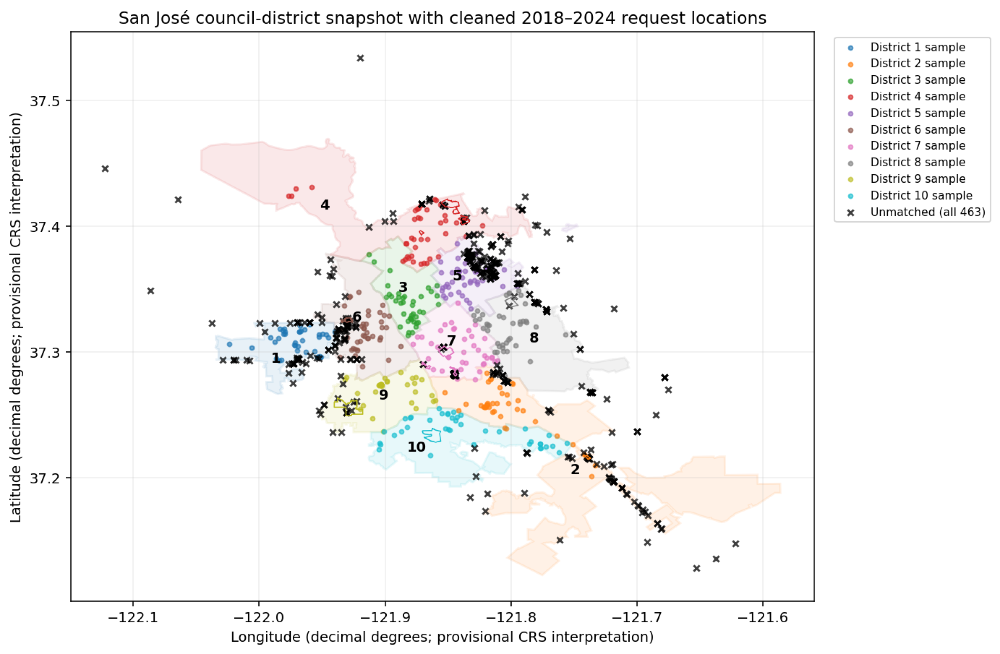
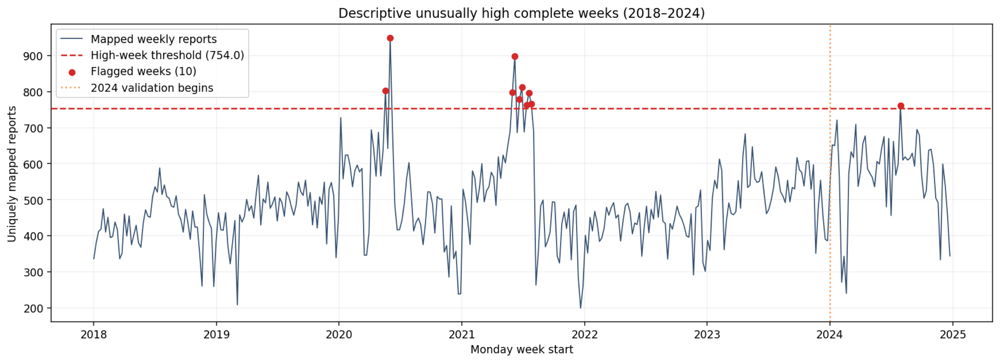
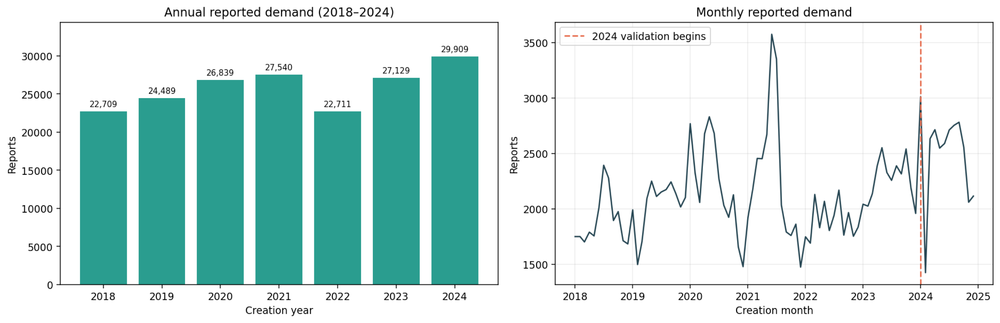
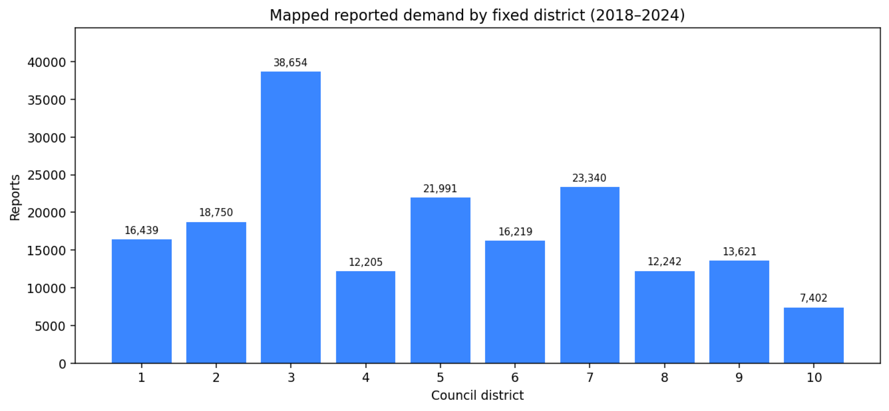
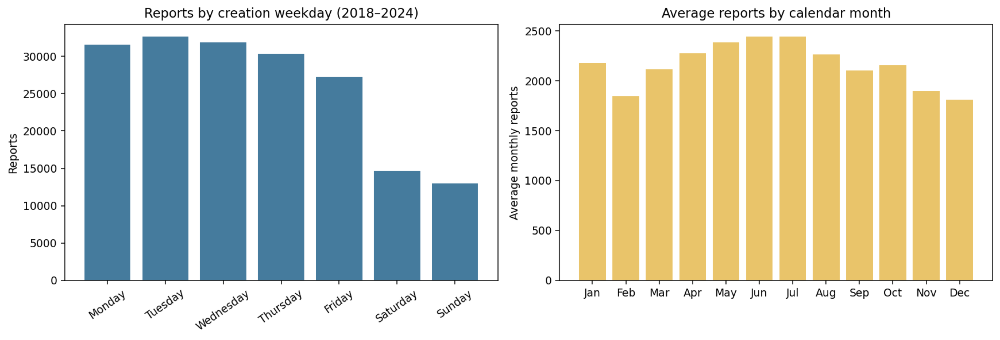
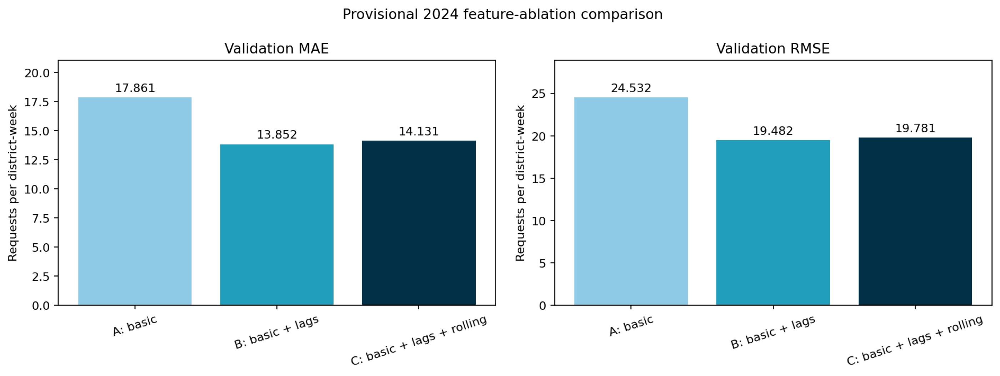

# Member 2 final presentation: district map, EDA, and forecasting features

## Evaluation and interpretation guardrails

- Forecast target: weekly San Jose 311 illegal-dumping **report counts** by council district, not confirmed dumping incidents.
- Model training: complete Monday-Sunday weeks in **2020-2023**.
- Development validation: 52 complete weeks in **2024** (520 district-weeks).
- Reserved final test: **2025; excluded from the EDA plots and model scoring, and not used to create these presentation assets**. The existing EDA notebook checks its row count as a split-reconciliation check.
- Charts labeled 2018-2024 are descriptive development-period EDA. The 2018-2019 observations provide historical context and lag support; they are not part of the official model-training period.
- Every model score shown below is a **2024 validation result**, not a final-test result.

## Slide 1 — Verified geographic assignment

**Verified findings**

- Boundary file: `data/reference/council_districts_snapshot.geojson`.
- Documented source: City of San Jose ArcGIS layer `PLN_AdministrativeBoundaries/MapServer/1`, named **City Council Districts (Current)**.
- The metadata describes the 2021 council districts, effective February 11, 2022, with possible later annexation or city-boundary updates.
- The snapshot contains exactly districts 1-10; all geometries are non-empty and valid polygons or multipolygons.
- Of 181,326 cleaned requests from 2018-2024, 180,863 map uniquely, 463 are unmatched, and none matches multiple districts.

**Speaker notes (20-30 seconds)**

We verified the exact archived boundary file used by the forecasting pipeline. It contains valid polygons for all ten council districts. Applying the project's point-in-polygon assignment to the 2018-2024 development records produced 180,863 unique matches, 463 unmatched points, and no multiple matches. Unmatched records were preserved for investigation rather than forced into a district.

## Slide 2 — Fixed historical geography: useful, but limited

**Map convention**

One archived current/2021-redistricting snapshot is applied to every request year. This creates a consistent retrospective geography for district time series, lags, rolling statistics, and model comparisons. It does **not** reconstruct the council district that legally governed every address when an older report was submitted.

**CRS distinction**

- The ArcGIS **source-layer metadata** reports native WKID `102643`, latest WKID `2227`, and map units in feet.
- The saved **GeoJSON export** has no explicit `crs` member and uses coordinates that look like San Jose longitude/latitude.
- The code consistently creates points as `(longitude, latitude)`, but the export query and requested output CRS were not saved.
- Therefore, the precise GeoJSON export CRS is unresolved; it must not be presented as verified EPSG:4326.

**Speaker notes (20-30 seconds)**

The same boundary snapshot is used for every historical year, which keeps geographic units consistent for forecasting. The tradeoff is that pre-redistricting records may not match the district legally in effect at the time. Also, the source layer's projected WKIDs are documented, but the exported GeoJSON does not declare its CRS, so we describe longitude-latitude use as internally consistent rather than claiming a verified EPSG code.

## Slide 3 — Weekly reporting demand is highly variable

**Verified findings**

- The chart covers 365 complete development weeks from 2018-2024 and marks the start of 2024 validation.
- The descriptive high-week threshold is 754 uniquely mapped reports, calculated as `Q3 + 1.5 x IQR` using development weeks only.
- Ten weeks exceeded this threshold.
- These are reporting-volume flags, not confirmed dumping events or causal explanations.

**Speaker notes (20-30 seconds)**

Weekly report volume changes substantially over time, including several sharp peaks. Ten development weeks exceeded the transparent IQR screening threshold. These flags show why one-week-ahead forecasting is challenging, but they should not be interpreted as confirmed dumping events. The dotted vertical line separates the 2024 validation period from the earlier development history.

## Slide 4 — Reported demand changed over time

**Verified findings**

- Annual descriptive volume increased from 22,709 reports in 2018 to 29,909 in 2024, a 31.7% increase.
- The pattern is not monotonic: 2022 fell to 22,711 reports before volume rose again.
- June 2021 was the largest development month, with 3,575 reports.
- Changes may reflect reporting channels, public behavior, source coverage, or definitions as well as underlying service demand.

**Speaker notes (20-30 seconds)**

Reported volume increased overall from 2018 to 2024, but the year-to-year pattern was not smooth, including a substantial decline in 2022. The monthly series also shows short-lived peaks, with June 2021 the highest month. These are descriptive 2018-2024 findings and may reflect changes in reporting behavior or data systems, not only changes in dumping activity.

## Slide 5 — District reporting volumes differ sharply

**Verified findings**

- District 3 has the largest fixed-map total: 38,654 reports, or 21.37% of uniquely mapped development reports.
- District 10 has the smallest total: 7,402 reports.
- District identity is therefore retained as a forecasting input.
- Totals are not adjusted for population, district area, land use, reporting access, or boundary history.

**Speaker notes (20-30 seconds)**

Report volumes vary considerably across the ten fixed districts. District 3 contributes the largest raw total, while District 10 contributes the smallest. That supports retaining district identity in the forecasting models. However, these are raw report counts, so they should not be interpreted as per-capita dumping rates or direct comparisons of district performance.

## Slide 6 — Calendar patterns describe reporting behavior

**Verified findings**

- Tuesday is the most common creation weekday, with 32,657 development-period reports.
- Reporting falls sharply on weekends.
- Average monthly volume is highest around June and July and lowest near the end of the year.
- Creation day is the report-submission day and may differ from the incident day.

**Speaker notes (20-30 seconds)**

The weekday distribution peaks on Tuesday and declines sharply on weekends, which likely captures reporting behavior as well as demand. Average monthly counts are highest around June and July. These patterns motivate calendar and cyclic seasonality features, while the interpretation remains report timing rather than verified incident timing.

## Slide 7 — Past weekly counts improve one-week-ahead validation

**Verified 2024 validation results**

| Feature group | MAE | RMSE |
|---|---:|---:|
| District + calendar | 17.861 | 24.532 |
| District + calendar + lags | **13.852** | **19.482** |
| District + calendar + lags + rolling/change | 14.131 | 19.781 |

- Lags are `lag_1`, `lag_2`, `lag_4`, and `lag_8`, calculated separately within each district.
- Rolling features shift by one week before aggregation, so the current target cannot enter its own predictors.
- Adding lags reduced MAE by 22.45% relative to the calendar-only group.
- Adding the complete rolling/change group did not improve upon calendar plus lags in this controlled comparison.

**Speaker notes (20-30 seconds)**

All three Poisson comparisons use the same 2020-2023 training rows and the same 520 district-weeks in 2024 validation. Adding past weekly counts reduced MAE from 17.861 to 13.852. Adding the full rolling and change group slightly increased MAE to 14.131. These are provisional validation results, not final 2025 test results.

## Feature-engineering summary

- Calendar: `month`, `week_of_year`, `sin_year`, `cos_year`.
- Lags: `lag_1`, `lag_2`, `lag_4`, `lag_8`.
- Shifted means: `rolling_4`, `rolling_8`, `rolling_13`.
- Shifted variability: `rolling_std_4`, `rolling_std_8`.
- Recent change: `lag_1 - rolling_4`.
- All historical features are grouped by district on a validated continuous weekly grid.
- The evaluation is rolling one-week-ahead validation: observed completed prior weeks may supply lag values, but the current week and future weeks cannot affect a prediction.

## Issues requiring team confirmation

1. Approve the fixed retrospective-geography convention for final reporting.
2. Decide whether a historical-boundary sensitivity analysis is required.
3. Recover the GeoJSON acquisition date and export query/output CRS if anyone retained them.
4. Confirm annual source completeness and the provisional zero-fill convention.
5. Confirm the local-wall-clock interpretation of source timestamps.
6. Ensure every result in the final deck is called a **2024 validation result** until the authorized final-test evaluation.

## Asset provenance

The presentation PNGs were exported from the already-executed, audited Member 2 notebook outputs. The feature-comparison image was copied from the existing committed Member 2 figure. The assets were resized to 2,800 pixels wide for slide use. No data, feature, model, validation prediction, or final-test evaluation was recalculated during export.
