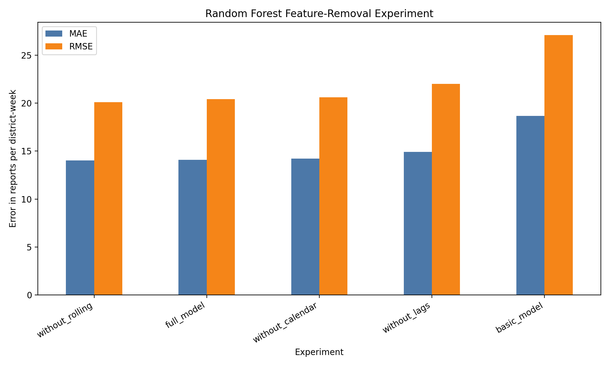
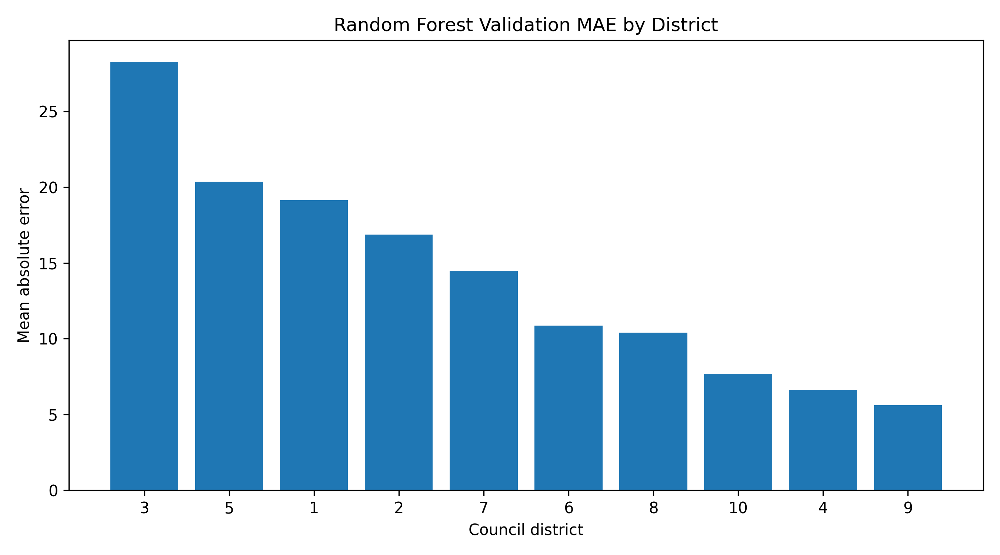

# Final presentation: Random Forest forecasting and error analysis

**Contributor:** Divija Puli

## Evaluation and interpretation guardrails

- The forecast target is the weekly number of San José 311 illegal-dumping reports by council district.
- The target represents reported service requests, not the confirmed number of illegal-dumping incidents.
- The Random Forest used complete weekly district records from 2020–2023 for training.
- The model was evaluated on 520 district-week records from 2024.
- The year 2025 was reserved for final testing and was not used for these results.
- All scores and error findings in this section are 2024 validation results.
- The results describe prediction performance and should not be interpreted as proof of why reporting activity changed.
- The model is intended to support workload planning and human review, not to make automatic decisions about districts or residents.

## Slide 1 — Random Forest forecasting setup

The Random Forest model predicts the number of illegal-dumping reports expected in each council district during the next week. The training data contains 2,080 district-week records from 2020–2023. The validation data contains 520 district-week records from 2024.

The model uses district information, seasonal calendar features, recent report-count features, and rolling activity features. The main historical features are report counts from one, two, and four weeks earlier. The rolling features summarize recent activity over four and thirteen weeks.

The analysis uses a chronological split. Earlier years are used for training, and a later year is used for validation. This setup reflects how the model would be used in practice because future records are not used to predict earlier weeks.

### Speaker notes (20–30 seconds)

My contribution focused on a Random Forest regression model for weekly illegal-dumping report counts. The model used district, calendar, lag, and rolling features. We trained it on 2020–2023 data and evaluated it on 2024 data. The 2025 records were kept separate for final testing. This time-based design gives a more realistic evaluation than randomly mixing earlier and later weeks.

## Slide 2 — Random Forest feature-removal experiment

The same Random Forest model was trained with five different feature settings. The purpose was to examine which groups of information helped the forecast.

| Feature setting | MAE | RMSE |
|---|---:|---:|
| Without rolling features | **14.03** | **20.11** |
| Full model | 14.09 | 20.41 |
| Without calendar features | 14.22 | 20.63 |
| Without lag features | 14.92 | 22.02 |
| Basic model | 18.68 | 27.10 |

### Verified findings

- The model without rolling features had the lowest MAE and RMSE.
- The full model was very close, but it performed slightly worse.
- Removing calendar features caused a small increase in error.
- Removing lag features caused a larger increase in error.
- The basic model, which used only district and calendar variables, performed the worst.
- All five experiments used the same 2,080 training rows and 520 validation rows.

### Interpretation

The lag features were useful because they gave the model information about recent report activity. Rolling features did not improve the Random Forest result in this experiment. The difference between the best model and the full model was small, so the results do not show that rolling features are always harmful. They only show that rolling features did not provide an additional benefit under this validation setup.

### Speaker notes (25–35 seconds)

We compared five versions of the same Random Forest model. The best result came from the model without rolling features, with an MAE of 14.03 and an RMSE of 20.11. Removing the lag features increased the error, showing that recent weekly counts were useful. The basic model performed much worse, which means that district and seasonal information alone were not enough. These results also show that adding more features does not automatically improve a model.

## Slide 3 — Random Forest validation errors by district

The error analysis used the 520 validation rows from the best `without_rolling` experiment. For each district, MAE measures the average difference between the predicted and actual weekly report count.

### Verified findings

- District 3 had the highest MAE at **28.27 reports per district-week**.
- District 5 had the second-highest MAE at **20.35**.
- District 1 had the third-highest MAE at **19.14**.
- District 9 had the lowest MAE at **5.61**.
- District 3 had an average error of **-10.03**, meaning the model generally predicted fewer reports than were recorded in that district.
- District 4 and District 9 had small positive average errors, meaning their predictions were slightly higher than the recorded counts on average.

### Speaker notes (20–30 seconds)

The error was not the same across all districts. District 3 had the largest average error, while District 9 had the smallest. District 3 also had a negative average error, which means the model generally underestimated the number of reports there. These differences may be related to district-level reporting patterns, but this analysis does not establish a specific cause.

## Slide 4 — Largest prediction errors

The largest individual errors came from weeks when the recorded report count was much higher or lower than the model prediction.

| District | Week beginning | Actual reports | Predicted reports | Error type | Difference |
|---|---|---:|---:|---|---:|
| 3 | July 29, 2024 | 227 | 124.82 | Underprediction | 102.18 |
| 5 | March 18, 2024 | 153 | 61.07 | Underprediction | 91.93 |
| 1 | January 8, 2024 | 133 | 50.26 | Underprediction | 82.74 |
| 3 | May 27, 2024 | 195 | 117.58 | Underprediction | 77.42 |
| 5 | March 25, 2024 | 54 | 126.07 | Overprediction | 72.07 |

### Verified findings

- The largest mistake was an underprediction in District 3 during the week beginning July 29, 2024.
- The actual count was 227 reports, while the model predicted 124.82.
- The largest overprediction occurred in District 5 during the week beginning March 25, 2024.
- The actual count was 54 reports, while the model predicted 126.07.
- The model had difficulty with some unusually busy and unusually quiet weeks.

### Speaker notes (25–35 seconds)

The largest errors occurred when weekly activity changed sharply. For example, the model underestimated District 3 by about 102 reports during the week of July 29, 2024. It also overestimated District 5 by about 72 reports during another week. These examples show that the model may not respond quickly enough to sudden changes in demand. They should be treated as error examples, not as explanations for why those changes occurred.

## Feature and leakage controls

- Lag features were calculated separately within each district.
- The lag variables used report counts from one, two, and four completed weeks earlier.
- Rolling features were calculated from earlier weeks only.
- The current week’s report count was not used as a prediction feature.
- Future weeks were not used to create earlier features.
- The same training and validation rows were used in every feature-removal experiment.
- The validation results were calculated only on 2024 records.

## Limitations

- The target measures reported 311 requests, not every illegal-dumping incident.
- The model was evaluated only on the 2024 validation period so far.
- The Random Forest results cover 2024 validation. The separate [2025 test](../../results/demand_forecasting_final/test_metrics.csv) evaluated Poisson and two baselines.
- The model may perform poorly when report activity changes suddenly.
- District-level errors may reflect reporting behavior, data coverage, or other factors that are not included in the model.
- The districts are compared using raw report counts and are not adjusted for population, area, land use, or reporting access.
- The final interpretation should be updated after the team completes its data checks and runs the reserved 2025 test.

## Reproducibility files

- Random Forest model script: `notebooks/03_classification/random_forest_forecasting.py`
- Error-analysis script: `notebooks/03_classification/random_forest_error_analysis.py`
- Feature-removal metrics: `results/member3_random_forest/random_forest_feature_removal_metrics.csv`
- Validation predictions: `results/member3_random_forest/random_forest_validation_predictions.csv`
- District error summary: `results/member3_random_forest/random_forest_error_by_district.csv`
- Largest errors: `results/member3_random_forest/random_forest_largest_errors.csv`
- Largest underpredictions: `results/member3_random_forest/random_forest_largest_underpredictions.csv`
- Feature-removal figure: `reports/figures/member3_random_forest/random_forest_feature_removal.png`
- District error figure: `reports/figures/member3_random_forest/random_forest_error_by_district.png`

## Asset provenance

The Random Forest figures were created from the committed validation predictions and feature-removal results. The error-analysis script selected the `without_rolling` experiment, calculated district-level errors, identified the largest prediction mistakes, and created the district MAE chart. No 2025 records were used in this analysis.
