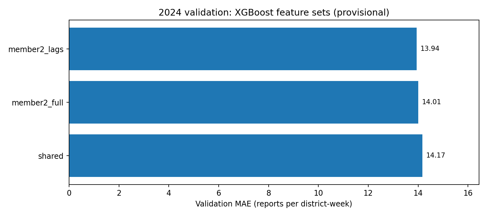
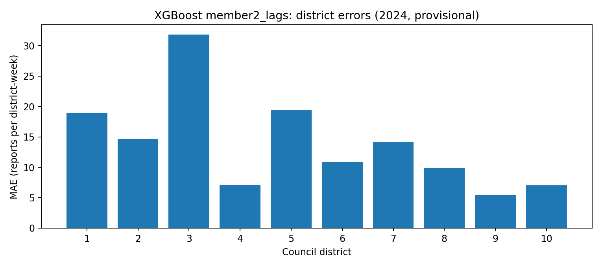
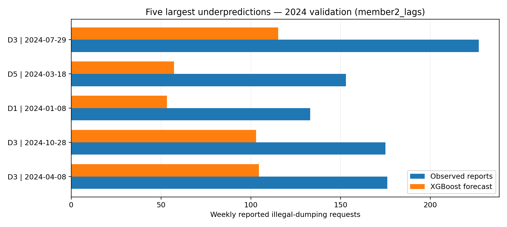
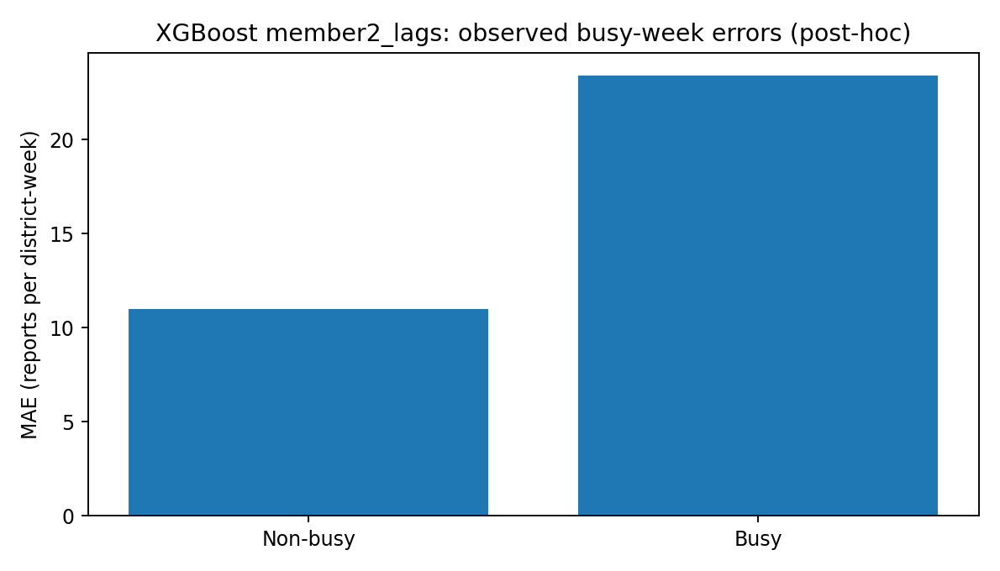
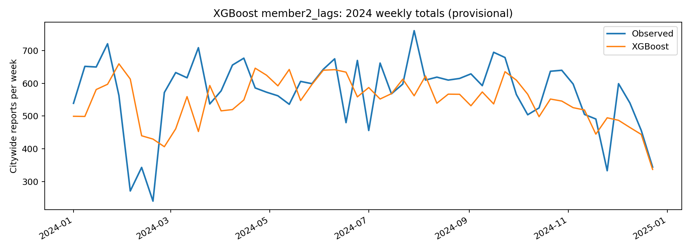
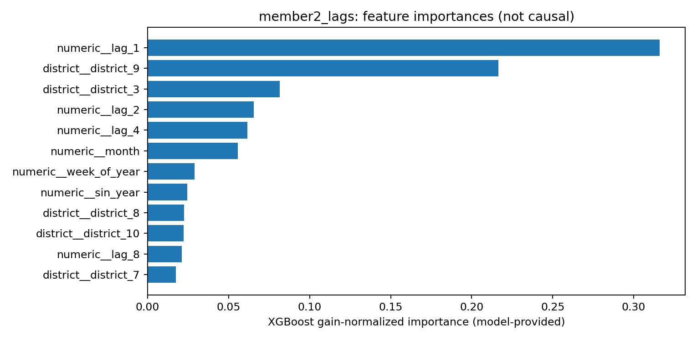

# Member 4 — Final Presentation: XGBoost Weekly Demand Forecasting

**Owner:** Xinghan Chen (Member 4)
**Task:** XGBoost forecasting, feature comparison, district-level and busy-week error analysis
**Evidence status:** **2024 validation (provisional)** — **2025 final test not used**
**Suggested allocation:** Four slides, approximately 2–3 minutes. The team lead can shorten the deck if needed.

## Evaluation setup and interpretation rules

- **Prediction target:** the number of *reported* San José 311 illegal-dumping requests in one council district during one complete Monday–Sunday week. These are report counts, not confirmed incidents or verified cleanups.
- **Forecast:** one week ahead, with lag/rolling variables built only from completed earlier weeks. During 2024 validation, earlier observed weeks can inform later one-week-ahead forecasts; the fitted model is held fixed.
- **Chronological split:** 2018–2019 supports lag history; **2020–2023 training** (**2,080 district-weeks**); **2024 validation** (**520 district-weeks = 52 weeks × 10 districts**). The week starting 2024-12-30 is not scored. **2025 remains reserved for the team-controlled final test.**
- **Models compared here:** three XGBoost feature configurations with identical fixed hyperparameters and validation rows. All errors are reported in **requests per district-week**.
- **Shared work:** Member 5 owns the district-week table and forecasting benchmarks; Member 2 owns the extra engineered features. Member 4 owns the XGBoost experiments and error diagnostics. Do not present the shared components as independently developed by Member 4.

---

## Slide 1 — XGBoost setup and feature comparison



**Slide content — 2024 validation (provisional)**

- Fixed XGBoost squared-error regression: **250 trees**, **depth 4**, **learning rate 0.05**.
- Same **2,080 training** and **520 validation** district-weeks for all three feature sets.
- **Best XGBoost feature set: `member2_lags`** — **MAE 13.942; RMSE 20.195**.
- The team Poisson benchmark achieved **MAE 13.643; RMSE 19.132** on the matching 2024 validation setup; XGBoost was **not** the best overall model in this comparison.

| XGBoost feature set | Validation MAE ↓ | Validation RMSE ↓ |
|---|---:|---:|
| Shared | 14.171 | 20.325 |
| **Member 2 + Lags (`member2_lags`)** | **13.942** | **20.195** |
| Member 2 Full | 14.007 | 20.356 |

**Speaker notes (about 35 seconds)**

> My original closure-duration regression task lacked a verified completion timestamp, so I followed the agreed XGBoost fallback. I forecast weekly reported illegal-dumping requests for each district. I compared three feature sets while holding the model settings and 2024 validation rows constant. Member 2's calendar and lag features gave the lowest XGBoost MAE, about 13.94 requests per district-week. However, the team's Poisson model had a slightly lower error, so we should not claim that XGBoost won the overall comparison.

---

## Slide 2 — District-level forecast errors



**Slide content — 2024 validation (provisional)**

- These diagnostics use **`member2_lags`**, the primary XGBoost configuration.
- **District 3** has the highest raw-count **MAE: 31.81** requests per district-week (**RMSE: 39.22**).
- District 3's average **prediction − observed** error is **−13.60** requests per week, indicating systematic underprediction on average.
- Differences in raw-count MAE are **not normalized** for population, reporting frequency, or area. They should not be interpreted as district service-quality or equity rankings.

**Speaker notes (about 25–30 seconds)**

> The overall model score hides large differences across districts. District 3 was particularly difficult, with an MAE of about 31.8 requests per district-week and an average negative prediction bias. These results indicate where the model's reported-demand forecasts are less reliable. Because the errors are measured in raw report counts, they do not tell us whether a district has more underlying dumping incidents or better or worse cleanup services.

---

## Slide 3 — Largest missed demand spikes



**Slide content — 2024 validation (provisional)**

- The plot ranks the **five largest individual underpredictions** of `member2_lags`; it was reproduced from saved validation predictions, **without retraining**.
- Largest miss: **District 3, week starting July 29, 2024**.
- **Actual reports: 227**; **XGBoost prediction: 115.20**; **underprediction: 111.80 requests**.
- A large error identifies an observed demand spike the model missed; it does **not** establish the cause of that spike.

**Speaker notes (about 25–30 seconds)**

> To make the district results more concrete, I examined the largest individual misses. The largest XGBoost underprediction was in District 3 during the week beginning July 29, 2024. The city received 227 reports in that district-week, while our forecast was about 115, a shortfall of nearly 112 requests. Several of the largest errors occurred during unusually high reported demand. We cannot infer their cause from the forecasts alone.

---

## Slide 4 — Busy-week errors and reproducibility



**Slide content — 2024 validation (provisional)**

- **Busy district-week:** its *observed* report count meets or exceeds the district-specific **90th percentile computed from 2020–2023 training counts**.
- **123 busy observations:** **MAE 23.42**, average prediction − observed error **−22.19**.
- **397 nonbusy observations:** **MAE 11.01**.
- The busy label is applied **after the actual 2024 count is observed**. This is **post-hoc diagnostic grouping, not a predictor** and not an advance busy-week classifier.
- **Reproduced environment:** Windows x64, **Python 3.13.15**, **XGBoost 3.4.1**, **NumPy 2.3.5**, **pandas 2.3.3**, **scikit-learn 1.7.2**. **17 Member 4 tests passed**; the saved 2024 scores were reproduced.

**Speaker notes (about 35–40 seconds)**

> I also separated errors by whether the observed district-week was unusually busy. The threshold was learned from the training period, and the label was assigned only after seeing the 2024 outcome. Busy weeks had an MAE of 23.42, compared with 11.01 for other weeks, and the forecasts tended to underestimate busy-week demand. This is an error analysis, not information available to the model when predicting. Finally, the results were reproduced in a pinned Python and XGBoost environment, and all 17 automated tests passed.

---

## Backup figures (not required on the four core slides)

### Backup A — Citywide weekly demand trend



This sums the ten district-level predictions and actual values for each week. It helps explain when the model captures the broad demand trend and misses sharp changes. **Do not present this as the basis of the MAE/RMSE values above:** those metrics were computed on individual district-weeks, not on citywide weekly totals.

### Backup B — XGBoost feature importance



Use only if asked which predictors appear important in the fitted model. The figure is a model diagnostic, **not evidence of causal effects**. The plotted feature-importance values correspond to the saved primary `member2_lags` model.

## Limitations and what the team still controls

1. **Reporting is not incidence:** 311 requests do not capture every actual illegal-dumping incident.
2. **Geography is retrospective:** the archived council-district boundary snapshot was applied to historical records. Member 2 and the team are responsible for the final boundary/CRS description.
3. **Coverage and zero-filling are provisional:** completeness of annual data and interpretation of missing versus zero-count weeks require team confirmation.
4. **High-demand analysis is retrospective:** the busy-week labels rely on observed validation targets and were never model inputs.
5. **2025 is reserved:** do not add or claim any final-test score until the team lead freezes the protocol and runs the agreed comparison. At that stage, update slide labels and scores from the authorized results.

## Reproducibility and asset provenance

**Existing model and result files already in `main`** (do not copy them again into this PR):

- `notebooks/04_resolution_regression/member4_xgboost.py` — original XGBoost training/evaluation code.
- `notebooks/04_resolution_regression/member4_xgboost_analysis.ipynb` — executed development notebook.
- `notebooks/04_resolution_regression/README.md` and `requirements_member4.txt` — installation, pinned environment, protocol.
- `results/member4_xgboost/validation_predictions.csv`, `validation_metrics.csv`, `district_metrics.csv`, `busy_week_metrics.csv`, `run_manifest.json` — saved 2024 results and provenance.
- `reports/figures/member4_xgboost/` — the five existing XGBoost figures displayed or linked above.

**Four files in this presentation PR:**

| New file | Why it is included |
|---|---|
| `notebooks/04_resolution_regression/FINAL_PRESENTATION_MEMBER4.md` | Four-slide, copy-ready results and speaker notes with directly embedded Markdown images |
| `notebooks/04_resolution_regression/xgboost_presentation_analysis.py` | Small read-only verification script using existing 2024 validation outputs; no model fit or 2025 data access |
| `results/member4_presentation/largest_underpredictions.csv` | Ten largest negative prediction errors for the primary XGBoost experiment |
| `reports/figures/member4_presentation/largest_underpredictions.png` | New presentation chart for the five largest individual underpredictions |

**To reproduce the new presentation assets from the repository root** (use the Member 4 environment documented in its README):

```powershell
python notebooks/04_resolution_regression/xgboost_presentation_analysis.py
```

The script reads only saved Member 4 validation outputs and the existing team validation predictions for cross-checking. It writes **only** the new `results/member4_presentation/` CSV and `reports/figures/member4_presentation/` PNG. No XGBoost model retraining, shared panel regeneration, 2025 evaluation, or modifications to teammates' files are involved. The 17 original unit tests may be run with:

```powershell
python -m unittest discover -s notebooks/04_resolution_regression -p test_member4_xgboost.py -v
```

### Review checklist

- [x] All slide-level metrics trace back to the uploaded `main` repository's saved 2024 results.
- [x] District and busy-week metrics and the largest underprediction were reproduced from prediction rows.
- [x] All four presentation-specific files are separated from existing merged model files.
- [x] Figure paths are relative to the Markdown file's location in `notebooks/04_resolution_regression/`.
- [x] Member 4's 17 existing tests passed in verification; the lightweight presentation script also executed successfully.
- [ ] Team lead has reviewed and incorporated the selected slides.
- [ ] Team has finalized the data-coverage and district-map assumptions and authorized the 2025 final-test report.
